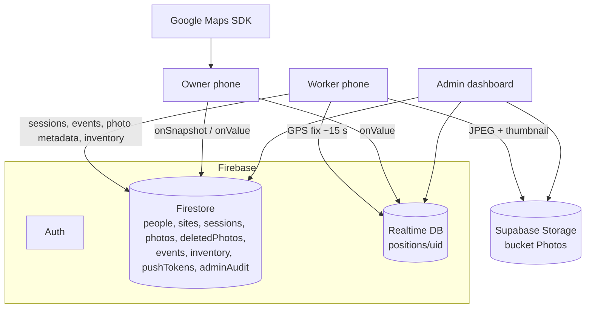
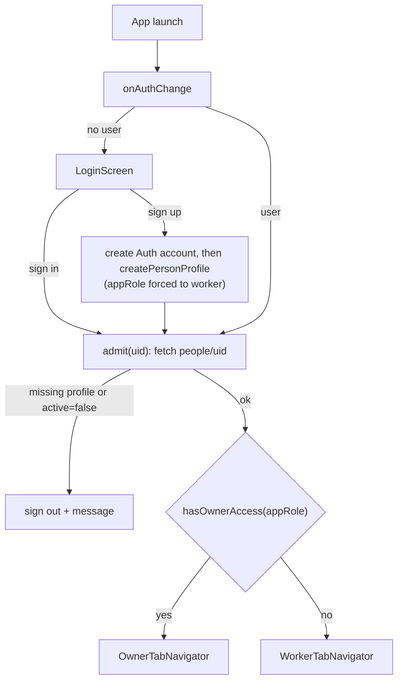
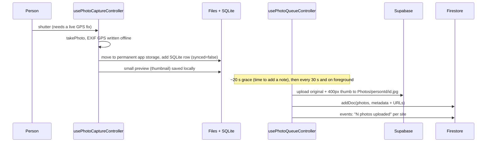

# Site Tracker (Android app) — Documentation

> **Last verified:** 2026-11-04, against `origin/main` @ `c01a356` ("pulled main", 2026-10-28) — **not** the
> files currently checked out in this folder (see §1).
> **Scope:** the Expo / React Native app (`com.sitetracker.app`). The web console has its own `DOCUMENTATION.md` in the
> `site-tracker-admin` repo. Both use **one Firebase project**, so §11 ("Contract with the admin dashboard") matters to both.
>
> **Keeping this file true:** see §15. Any change to code, config, rules, schema or env vars should come with an edit here and a
> changelog line in `PROJECT_CONTEXT.md`.

---

## 1. ⚠️ Repo state you must know about

This folder's checked-out branch is **stale and broken**, and the docs below describe the *latest* code instead:

| Thing | Finding |
|---|---|
| Checked out | local `develop` @ `f668702` (2026-09-03): **63 source files**, Mapbox-based, mock data, no Firebase |
| Conflict markers committed | `CLAUDE.md`, `package.json`, `.env.example`, … contain `<<<<<<< HEAD` / `>>>>>>> 2c570b8…` lines |
| Latest code | **`origin/main` @ `c01a356`** (222 files; Firebase + Supabase + Google Maps, Expo SDK 57). `origin/inventory-entry` @ `d92bc1a` is its parent line. Local `main` is 26 commits behind. |
| Git | `git status` in this folder errors with "must be run in a work tree" (the repo config needs checking) |

Nothing was changed in your checkout to avoid losing work. To work on the real app, back up anything uncommitted, then
`git fetch` and check out `main` (or merge it into `develop`). Until then, `docs/`, `modules/`, `firestore.rules`, `eas.json`
etc. described here do not exist in this folder. This documentation and `AGENTS.md`/`PROJECT_CONTEXT.md` are **new, untracked files**.

## 2. What the app does

Two experiences chosen by `people/{uid}.appRole` (never by the user at login):

| | **Worker** (`worker`) | **Owner / Admin** (`owner`, `superadmin`) |
|---|---|---|
| Tabs | Home · Camera · Photos · Items · Map · Profile | Map · Crew · Camera · Photos · Activity · Profile |
| Core | Pick an assigned site and **check in**; location is shared only while checked in and not paused; take **geotagged photos**; log **items received/used**; see site-mates on a map | See the **whole crew live** on a (3D) map, tap-through to person/photos, manage crew (job title, deactivate; superadmin: owner↔worker), browse every photo, live **activity feed** |
| Photos | Own photos only, offline-first, auto-upload | Everyone's photos (newest 60), filter by person/site/date, full-screen viewer |

Sites, projects and crew assignment are created in the **admin dashboard**; the app only reads them. A site has no location.

## 3. Tech stack

| Concern | Choice |
|---|---|
| Framework | **Expo SDK 57**, **React Native 0.86**, React 19.2, TypeScript ~6.0 (`strict`). **New Architecture only**; Android targets API 36 with edge-to-edge. Custom **dev client** (not Expo Go). |
| Navigation | React Navigation 7 bottom tabs, auth-gated root, custom `AppTabBar` |
| State | Zustand 4 — one store per domain, selector subscriptions |
| Maps | `react-native-maps` (Google provider, 3D buildings, compass/tilt "motion mode" via `expo-sensors`); static schematic fallback with no key |
| Camera | `react-native-vision-camera` 4.7.3 (photos only; microphone disabled) |
| Location | `expo-location` + `expo-task-manager` (Android foreground service); local Kotlin native module for **activity recognition** (`modules/activity-recognition`) |
| EXIF | `piexifjs` — GPS written into the JPEG on the phone, offline |
| On-phone data | `expo-sqlite` (photo list), AsyncStorage (shift, inventory outbox, settings), `expo-file-system` (files) |
| Identity | Firebase Auth (email/password) |
| Data | Firestore (static data) + Realtime Database (live positions) — split by billing model, see §4 |
| Photo files | **Supabase Storage** (public bucket `Photos`) — Firebase Storage needs a billing account |
| Other | `expo-notifications` (token registration), `expo-battery`, `expo-image-picker`/`image-manipulator` (avatar, thumbnails), Plus Jakarta Sans, `react-native-keyboard-controller`, `open-location-code` (plus codes) |
| Build | Android package `com.sitetracker.app`, `minSdkVersion 26`; local builds target `arm64-v8a` + `x86_64` only; EAS profiles `development`/`preview` (APK) and `production` (AAB) |
| Tests | Jest (`jest-expo`) + Testing Library — **37 test files** |

## 4. Architecture

### 4.1 System topology



Why three stores: **Firestore bills per read/write** (fine for slow data); **RTDB bills per byte** (cheap for tiny GPS fixes every
15 s); **Supabase** gives 1 GB of file storage with no card. A `Person` on the map is assembled on the phone by merging a
Firestore profile with an RTDB position (`peopleApi.mergePersonProfile`).

### 4.2 Layering rule (enforced by convention — `CLAUDE.md`)

```
screens  → render, call ONE controller hook
components → props in, JSX out
controllers (use<Thing>Controller) → the only place that combines service + api + store
api/      → Firebase / Supabase calls, no React
services/ → device/OS I/O (GPS, camera EXIF, SQLite, files, permissions), no app state
store/    → Zustand state + simple setters, no side effects
utils/    → pure functions
types/    → shared vocabulary (imports nothing from src)
```

No inline magic values: colours/spacing/radii/type from `src/constants/theme.ts`, tunables from `src/constants/config.ts`.
No `any` to silence the compiler; unknown third-party types go in `src/types/*.d.ts`.

### 4.3 Folder map (`src/`, 184 files at `origin/main`)

| Folder | Contents |
|---|---|
| `api/` | `firebaseClient` (single app + auth/firestore/rtdb), `supabaseClient` (Storage only), `peopleApi`, `photosApi`, `sessionsApi`, `sitesApi`, `eventsApi`, `inventoryApi`, `deletedPhotosApi`, `adminAuditApi` |
| `services/` | `locationService` (bg task + precise watch), `sharingService`, `activityRecognitionService`, `batteryService`, `exifService`, `localMediaService`, `photoDatabase`, `photoQueueStorage`, `remotePhotoCache`, `thumbnailService`, `thumbnailCacheService`, `shiftStorage`, `inventoryOutbox`, `captureTaskStorage`, `authService`, `pushService`, `permissionsService`, `avatarService`, `linkingService`, `motionService`, `appInfoService` |
| `controllers/` | 24 hooks, see §6 |
| `store/` | `useAuthStore`, `useCrewStore`, `usePhotoStore`, `useEventStore`, `useShiftStore`, `useInventoryStore` |
| `screens/` | `common/` (Login, Camera, Profile), `owner/` (Map, Crew, Photos, Activity), `worker/` (Home, Queue "Photos", Inventory "Items", SiteMap) |
| `components/` | `common/`, `owner/`, `worker/` presentational pieces (sheets, cards, map markers, camera controls) |
| `navigation/` | `RootNavigator`, `OwnerTabNavigator`, `WorkerTabNavigator` |
| `constants/` | `theme.ts`, `config.ts`, `mockData.ts` (no-backend fallback + seed script source) |
| `utils/` | formatters, geo (distance, plus codes, trails), photos, inventory, siteCrew, activity, activityFeed, camera, color, motion, roles, captureTask, photoFilters |
| Root | `App.tsx`, `app.config.ts`, `metro.config.js`, `firestore.rules`, `database.rules.json`, `firestore.indexes.json`, `firebase.json`, `eas.json`, `scripts/`, `modules/`, `docs/`, `patches/` |

## 5. Running and building

```bash
cp .env.example .env          # fill in values (never commit .env)
npm install                   # runs patch-package
npx expo prebuild -p android  # generates android/ (gitignored)
npm run android               # builds + launches the dev client
npm start                     # Metro with --dev-client
npm run typecheck | lint | test | format
firebase deploy --only firestore:rules,firestore:indexes,database    # after ANY rules/index change
```

Environment (`EXPO_PUBLIC_*` values are **inlined into the JS bundle = public**): `EXPO_PUBLIC_FIREBASE_API_KEY`, `_AUTH_DOMAIN`,
`_PROJECT_ID`, `_MESSAGING_SENDER_ID`, `_APP_ID`, `_DATABASE_URL`; `EXPO_PUBLIC_SUPABASE_URL`,
`EXPO_PUBLIC_SUPABASE_PUBLISHABLE_KEY`; `EXPO_PUBLIC_GOOGLE_MAPS_API_KEY` (also written into the Android manifest by
`app.config.ts`, so changing it needs a rebuild; restrict it by package + SHA-1 in Google Cloud).
**No Firebase config ⇒ dev bypass:** `HAS_FIREBASE_CONFIG` is false → any credentials sign in with a fabricated profile ("worker" in the
email ⇒ worker, else owner), data comes from `mockData.ts`, check-in uses a `local` session. It disappears once a `projectId` is set.

On first launch grant **"Allow all the time"** location and camera, or worker flows silently do nothing.
Seed accounts: `scripts/seedFirebase.js <serviceAccountKey.json>` (own `package.json`, never bundled; key files are gitignored).
`metro.config.js` exists to stop Metro watching gigabytes of native build output inside `node_modules` (which made the dev launcher time out).

## 6. How each feature works

### 6.1 Auth and role routing (`useAuthController`, `authService`, `RootNavigator`)



- `profile` is three-state: `undefined` = still checking (spinner), `null` = signed out, object = signed in. This prevents a login-screen flash.
- Sign-up race: Firebase fires `onAuthStateChanged` before the profile doc exists, so a **single-shot module flag**
  (`suppressNextAuthChange`) swallows that one event. A failed profile write signs the new account back out.
- Deactivated (`active === false`) or profile-less accounts are refused at sign-in; the Auth account itself can only be deleted via the Admin SDK.
- Push token registered after sign-in unless switched off in Settings. Sign-out first **ends any open shift** (`endShiftOnSignOut`),
  stops tracking, closes live listeners (otherwise Firestore rejects them with permission-denied).
- Self-signup creates **workers only** (rules). Owners/superadmin are made in the console/seed script; superadmin can flip owner↔worker from the Crew screen.

### 6.2 Check-in / shift (`useShiftController`, `sessionsApi`, `shiftStorage`)

1. Home lists the person's **assigned sites** (fresh read of `people/{uid}.siteIds` → `sites` by id; the admin may have assigned since sign-in).
2. **Check in** (needs network — `ponytail`): asks location (+ optional activity recognition) permission, opens a `sessions` doc
   `{personId, siteId, start}`, saves the `ActiveShift` locally (survives restarts), starts sharing, sets RTDB `positions/{uid}.siteId`
   and `paused:false`, logs a `checkin` event.
3. **Pause** closes the session (`endReason:"paused"`) and stops tracking; **Resume** opens a *new* session on the same site.
4. **Check out** closes the session (`signed-off`), clears `siteId`, logs `checkout`. It never blocks on the network: a session that can't be closed is
   left open and the dashboard estimates its end from the last position fix.

Hours on the dashboard come from these `sessions`.

### 6.3 Live location (`locationService`, `sharingService`, `useLocationSharingController`)

| | Background tracking | Camera-screen watch (`watchPreciseFix`) |
|---|---|---|
| Accuracy | `Balanced` | `BestForNavigation` |
| Cadence | 15 s or 20 m moved | 500 ms |
| Lifetime | While checked in and not paused; survives app close (foreground service notification) | While Camera mounted; also a foreground "GPS warm-up" while signed in (`useGpsWarmupController`) |
| Used for | Crew map (`positions/{uid}`) | Photo geotag + live accuracy badge |

`TaskManager.defineTask` runs at **module load** (Android may relaunch the bundle headless). Each fix: `kind` from the OS activity recognizer when recent
(≤3 min) and confident (≥60), else from GPS speed (vehicle >2.5 m/s, walk >0.3 m/s); battery level attached; local crew store updated at once;
`positions/{uid}` updated fire-and-forget (`lat,lng,accuracy,kind,battery,siteId,lastFixAt: serverTimestamp`). One `battery` event per drop to ≤20%.
A person is shown `stale` if their last fix is older than 3 min (computed on read). The camera watch self-heals (retry on failure; watchdog restarts after 8 s of silence)
and **never seeds from a cached position**: a photo must not be geotagged with a stale location.

### 6.4 Photo capture → sync (`usePhotoCaptureController`, `usePhotoQueueController`, `photosApi`)



- Capture is **offline-first and the only copy lives in the app's private storage** (nothing goes to the gallery). Uninstall or clear-data before sync loses it.
  Id = `local-<takenAt>-<random>`; file name encodes person, time, lat/lng, accuracy, task.
- Each capture is stamped with `siteId` (current shift), `personName`, `task` label (default "General", recent labels as chips), optional **note** (≤500 chars) and optional
  link to one of the person's inventory entries (`inventoryId`).
- **Auto-upload** (`AUTO_SYNC`: 20 s grace, 30 s retry, on foreground). Held back while that photo's note sheet is open or while it is in the camera **tray**
  (this camera visit's captures) — because **a synced photo's Firestore record is never edited**, notes must go up with it. Upload one at a time; each is marked synced as soon as it lands;
  the first failure is flagged `failed`, others return to queued; a module-level `inFlight` set prevents double sends. Uses `arrayBuffer()` not `blob()` (RN's Blob truncates large files).
- **Offline lists:** the screen shows SQLite immediately (own captures + the last backend list, `origin` = `local`/`remote`), then refreshes from the network. Other people's thumbnails are cached (max 120).
- **Admin deletion:** the dashboard writes `deletedPhotos/{id}` tombstones; the phone reads its own on load and on returning to foreground and removes the row, file and preview (only for already-synced photos).
- Role scoping: owner fetches all recent photos, worker only `where personId == uid` (rules reject an unfiltered worker query). The photo store records `loadedFor` so a second person on the same handset never inherits the first's list.

### 6.5 Items / inventory (`useInventoryController`, `inventoryApi`, `inventoryOutbox`)

Crew log what is **received at a site** (name, quantity, unit chips or custom, optional "5 packs × 5 m", note). Entries get a phone-made Firestore id, are saved to an
AsyncStorage **outbox** immediately and sent to Firestore (retry every 30 s and on foreground; a leftover entry is checked with `inventoryEntryExists` before re-sending).
Everyone assigned to a site can **read** all its entries (live `where siteId in …`, max 30 sites); only the **creator** may log usage (appends one `usage` item and bumps `usedQuantity`);
nobody on the crew can edit/delete afterwards — only the dashboard can ("Corrected" via `editedAt`).
⚠️ This is the **older per-entry model**; the dashboard's new Project → site allocation → usage model is not in the app yet (§13).

### 6.6 Owner screens

- **Map** (`useLiveMapController`, `LiveCrewMap`): crew markers (avatar + heading arrow when moving), motion trails (last 30 points), 3D/flat, 4 base styles, follow a person, "motion mode" (compass+tilt steer the camera), whole-crew and my-location buttons. Deactivated people are hidden.
- **Crew** (`useCrewManagementController`, `PersonDetailSheet`, `CrewMemberActions`): roster with live status; edit job title, deactivate/reactivate (not yourself), owner↔worker (superadmin only); each change is logged as an event.
- **Photos**: grouped by day, filter sheet (person/site/date), pending-upload bar for the owner's own captures, `PhotoViewer` (pinch/double-tap zoom, who/when/where).
- **Activity**: compact day-grouped feed of the newest 100 events, filter by person/site/type, repeats within 10 min merged ("×2"), rows open the person or their photos.

### 6.7 Profile / Settings (`useProfileController`, `useSettingsController`)
Own name and avatar (160 px JPEG stored inline as a data URI ≤150 KB on the profile), sign-out, app version, location permission (always / while using / blocked) and notification switch; permissions are re-read when the app returns to the foreground.

## 7. Data model (`src/types/domain.ts`)

| Type | Where it lives |
|---|---|
| `PersonProfile` | Firestore `people/{uid}`: `name, role (job title), color, appRole, active?, avatar?, siteIds?, email?, phone?, team?` |
| `Person` (map) | profile + RTDB `positions/{uid}`: `lat,lng,accuracy,lastFixAt,battery,paused,kind,siteId` |
| `Site` | Firestore `sites/{id}`: read only (`name`, `code`) — created in the dashboard |
| `PresenceSession` | Firestore `sessions/{id}`: `personId, siteId, start, end?, endReason` |
| `Photo` | Firestore `photos/{id}` (metadata) + Supabase `Photos/{personId}/{photoId}.jpg` and `_thumb.jpg`; on device SQLite `photos` table (`viewer_id, id, origin, taken_at, data JSON`) |
| `DeletedPhoto` | Firestore `deletedPhotos/{id}`: `personId, takenAt, deletedAt` |
| `AppEvent` | Firestore `events/{id}`: `text, kind info|warn, type checkin|checkout|pause|resume|upload|battery|crew|site, personId, siteId, at` |
| `InventoryEntry` | Firestore `inventory/{id}`; outbox copy in AsyncStorage |
| `ActiveShift` | AsyncStorage per person (`siteId, siteName, checkedInAt, sessionId, paused`) |
| Push token | Firestore `pushTokens/{uid}` (nothing sends pushes yet) |
| Audit | `adminAudit` — written by the dashboard; `adminAuditApi.logAdminAction` exists in the app too (superadmin read only) |

## 8. Security model

**Firestore** (`firestore.rules`; default-deny; `isOwner()` = active owner/superadmin; deactivated people count as signed out for writes):

| Collection | Read | Write |
|---|---|---|
| `people` | any signed-in | self-create once as worker (4 keys); owner updates `role,active,siteIds,email,phone,team,invitedAt` (never own `active`); superadmin toggles `appRole` owner↔worker (not self/other superadmin); self `name`+`avatar` (≤150 KB); never delete |
| `sites` | signed-in | owner |
| `sessions` | owner all; worker own (query must filter `personId`) | create own (no `end`); close own once (`end`,`endReason`); owner corrects times/site (`editedAt`); delete superadmin |
| `photos` | owner all; worker own | create as self; never update; delete owner |
| `deletedPhotos` | owner / own | owner create; delete superadmin |
| `inventory` | owner; or siteId ∈ my `siteIds` | create for my own sites; creator appends usage only; owner edits/deletes |
| `events` | signed-in | create if active; delete superadmin only |
| `adminAudit`, `adminViews` | superadmin | owner create (whitelisted keys, size caps); `adminAudit` append-only |
| `pushTokens` | owner | own doc |
| **RTDB `positions`** | signed-in | own `positions/{uid}` only; `siteId` indexed |

**Supabase** bucket is **public with a publishable key shipped in the app**: any key holder can list/read/overwrite any person's files; the `{personId}/` prefix is organisation, not security.
The dashboard deletes with the service-role key, server-side only.

## 9. Testing

37 test files under `__tests__/`: API (`peopleApi`, `photosApi`, `eventsApi`, `deletedPhotosApi`), controllers (auth, camera session, crew management, GPS warm-up, live map, map motion,
photo capture, photo queue, profile, settings, shift), services (EXIF, local media, location, motion, photo queue storage, remote cache, shift storage), stores, utils, `ZoomableImage`.
Screens and most components have no tests. The 2026-10-09 E2E report is `docs/test-reports/e2e-report-2026-10-09.pdf`. These were **not run** for this document.

## 10. Other docs in the repo (all at `origin/main`)

`PROJECT_OVERVIEW.md`, `README.md`, `CLAUDE.md` (engineering guide), `docs/cost-and-limits.md` (free tiers/prices, researched 2026-10-07),
`docs/photo-storage-limits.md`, `docs/storage-backend-comparison.md` (Cloudflare R2 move under consideration), `docs/READ-BEFORE-BUILDING-PHOTO-DELETION.md`,
`docs/session-handoff-2026-10-05.md`, user-manual and storage-options PDFs.
**Several are out of date — see §14.**

## 11. Contract with the admin dashboard (shared Firebase project)

| Item | App | Dashboard |
|---|---|---|
| `firestore.rules`, `database.rules.json`, `firestore.indexes.json` | **owned here**, deployed from here | needs the same; new collections need rules here first |
| `people` owner-only fields (`siteIds,email,phone,team,invitedAt,active,role`) | reads | writes |
| `sessions` | writes (check-in/out/pause/resume) | reads, corrects, estimates ends of dead sessions |
| `positions/{uid}.siteId` | writes while checked in | reads; clears on site delete |
| `photos` fields (`uri,thumbUrl,width,height,siteId,personId,personName,task,note,inventoryId,mediaType`) | writes | reads, deletes (file + thumb + record) |
| `deletedPhotos` | reads + removes local copy | writes tombstone |
| `events` shape | writes | reads, appends |
| `inventory` | creates, usage | edits, deletes |
| Constants kept equal | `BATTERY.lowLevel` 0.2, `GEOTAG_ACCURACY.goodMeters` 20, stale 3 min | `LOW_BATTERY`, `GOOD_ACCURACY_M`, `STALE_AFTER_MS` |

## 12. Known limits (by design / `ponytail`)

- Check-in needs the network (no offline check-in). Inventory list is unbounded and sorted on the phone.
- Auto-sync only runs while the app process is alive and signed in; captures on a phone that is uninstalled/cleared before sync are lost.
- Zoomable image drag isn't clamped to the photo edge.
- Push notifications are registered but **nothing sends them** (needs a server trigger, i.e. Blaze plan).
- Supabase bucket has no per-user isolation (decision pending: Edge Function verifying Firebase token vs back to Firebase Storage vs Cloudflare R2).
- No arrival/leave geofence events (the Sites/geofence tab was removed; sites have no location).
- A failed profile write at signup leaves an inert Auth account (remove in console).

## 13. Risks and gaps found during this review

1. 🚨 **`firestore.rules` has no rules for `projects`, `projectInventory`, `siteInventory`, `inventoryUsage`.** The dashboard's in-progress Projects feature
   needs them (otherwise it is denied and renders nothing). Add and deploy them from here; decide what crew may read/write if the phone adopts allocations.
2. **The phone app doesn't use the new project-stock model** (still `inventory` entries).
3. **Local checkout is stale/conflicted** (§1).
4. A fixed-credential seed admin is committed in `scripts/seedFirebase.js` — change it before real users.
5. `CLAUDE.md` still contains the "Memory Integrity disabled" standing question (the overview says the emulator issue was resolved) — confirm with the user and delete if done.

## 14. Doc drift inside the repo (don't trust these over the code)

- `PROJECT_OVERVIEW.md` still lists `siteApi`, `useGeofenceController`, `useSiteStore`, a Sites tab and a geofence slider that no longer exist; says 7 controllers (there are 24);
  and says battery, activity recognition, multi-site and employee management are unfinished, but they exist now. `README.md`/`CLAUDE.md` still call parts of `api/` mocked and mention the old structure.
- `docs/session-handoff-2026-10-05.md` itself records that docs were out of date at that point.

## 15. Documentation maintenance protocol

| If you change… | Update |
|---|---|
| tabs / screens / user-visible behaviour | §2, §6 |
| a controller/service/store or folder | §4.3, §6 |
| Firestore/RTDB/Supabase field, collection, rule or index | §7, §8, §11 **and the dashboard's DOCUMENTATION.md** |
| dependencies, SDK versions, build/env vars | §3, §5 |
| a bug fixed or limit found | §12, §13 |

The AI assistant working here is instructed (`AGENTS.md`, `PROJECT_CONTEXT.md`) to end any reply that changed behaviour with a one-line reminder to do this.
