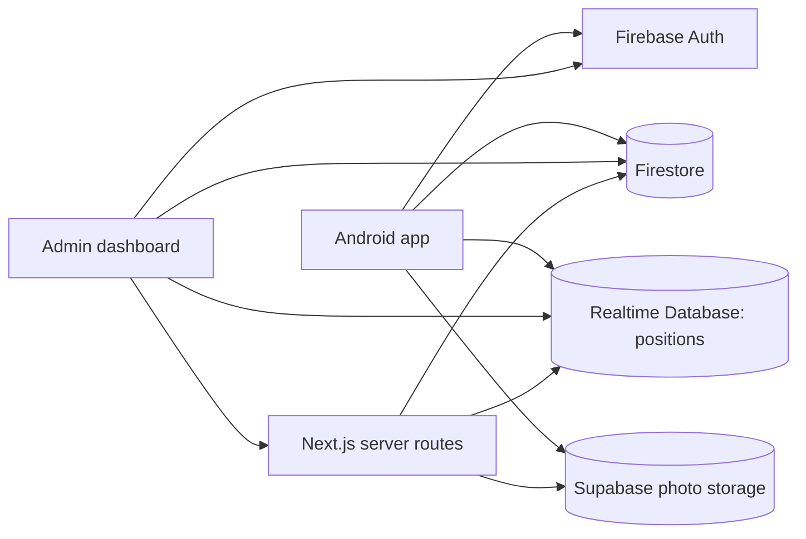

# Site Tracker: Android and admin dashboard review

**Review date:** 6 November 2026  
**Purpose:** Explain both applications, their shared data, current risks, and practical next steps.

## Scope and confidence

The Android checkout is `develop` at `d827f41`; its project instructions identify the locally available `origin/main` at `c01a356` as the intended app. Android source and rules discussed below refer to that **local Git reference**, inspected without changing branches. No fetch was performed, so this report does not establish whether the remote has newer commits. The Android checkout also has an untracked `.claude/` directory.

The dashboard checkout is `develop` at `e1fb2bc`, with a clean working tree at the start of this review. The documentation describes an older dashboard revision and previously uncommitted work, so its repository-status statements are outdated. The dependency graphs were generated for different commits and are useful for navigation, not authoritative descriptions of the current revisions.

This is an expanded architectural and risk-focused source review of authentication, roles, tracking, attendance, inventory, photos, privileged routes and cleanup, supported by existing project documentation. It is **not** a line-by-line review of every source file, a live Firebase configuration review, or a production security assessment. No deployed rules, cloud configuration, or actual user data were inspected. Findings below are source analysis unless a test result is explicitly stated.

## Executive overview

Site Tracker consists of an Android field app and a browser-based administration dashboard. Firebase Authentication identifies users; Firestore holds profiles, sites, attendance, photos and other business records; Firebase Realtime Database (RTDB) holds live locations; Supabase Storage holds photo files. The dashboard also contains server routes for actions requiring privileged credentials.

The highest-priority issues are the owner-accessible project deletion path that can delete sites, and orphan cleanup's incomplete reference scan, which can classify live photos as orphans at scale. Separately, the Android repository's reviewed Firestore rules do not contain the dashboard's newer `projects`, `projectInventory`, `siteInventory`, or `inventoryUsage` collections. If the deployed rules match those files, dashboard project listeners are denied and the readiness gate cannot complete. Deployed rules must be checked before concluding that production is affected.

The mobile app and dashboard also currently use different inventory models. The phone records receipt and usage against legacy `inventory` entries, while the dashboard additionally supports project stock, allocations and usage in separate collections. Those flows do not automatically reconcile.

## System architecture

The Firestore and RTDB rules in Android `origin/main` are intended to govern both clients. Client-side role checks improve the interface, but actual access depends on deployed backend rules and server authorization. Privileged Admin SDK operations bypass Firestore rules and therefore require correct server-side checks.

## Android app

### Stack and organization

The reviewed app uses Expo SDK 57, React Native 0.86, React 19, TypeScript, React Navigation and Zustand. It targets Android with a custom development client. Google Maps, Vision Camera, Expo Location, SQLite, AsyncStorage, Firebase and Supabase support its main features. A local Android native module provides activity-recognition integration.

The intended layering is screens and components for presentation, controller hooks for orchestration, API modules for backend access, services for device operations, Zustand stores for state, and shared types/utilities. See [Android documentation](DOCUMENTATION.md) for the full folder map and feature descriptions. Since the checked-out branch differs from the reviewed app, view individual Android files with `git show origin/main:<path>` until the correct revision is checked out safely.

### Roles and user flows

| Area | Worker | Owner / superadmin |
|---|---|---|
| Navigation | Home, Camera, Photos, Items, Map, Profile | Map, Crew, Camera, Photos, Activity, Profile |
| Attendance | Select assigned site, check in, pause/resume and check out | Monitor the crew and associated activity |
| Location | Share location while checked in and not paused | View crew locations |
| Photos | Capture geotagged photos, queue them offline and upload | Capture and browse photos across the crew |
| Inventory | Record site receipts and usage using legacy entries | See the related data in management interfaces |
| Access | Self-signup is constrained to worker profiles by reviewed Firestore rules | Role assignment is restricted; superadmin has additional management powers |

### Attendance and location

Check-in creates a `sessions` document and starts location sharing; pause closes the current session and resume creates another. Check-out closes the session and clears the site association. A failed offline close can leave an open session; dashboard calculations estimate an end from the last known position in applicable cases. Actual tracking depends on Android permissions and background execution behavior, so it needs physical-device testing.

The reviewed RTDB rules allow **any authenticated user to read all `positions`**, and each authenticated user to write their own position. They do not check the Firestore profile's `active` flag. This means deactivating a profile alone does not, under these reviewed rules, revoke an existing authenticated user's RTDB access; verify the deployed rules and decide whether this exposure matches the privacy model.

### Photos and offline behavior

Photos are stored on the phone and represented in a local SQLite-backed queue. The queue can display cached remote data while offline, uploads pending items, and retries failed transfers while the relevant app controller is running. The original is uploaded to Supabase, followed by an optional thumbnail and a Firestore metadata record. Notes must be added before the immutable metadata record is uploaded. Offline photos may exist only on the device until successful sync, so uninstalling or losing the device can lose pending captures.

Deletion is a cross-system operation: remove the original and thumbnail, write a `deletedPhotos` marker, and delete the Firestore record. The phone checks markers when loading or returning to the foreground and removes matching synced local copies. Deletion is eventually reflected, not instantaneous on an offline phone.

The reviewed upload implementation uses an automatically generated Firestore document ID. If the metadata write succeeds but the client fails before marking the local item synced, a retry can create another metadata record for the same storage paths. This is a potential duplicate-record failure mode; validate with an interrupted-upload test and consider a stable document ID or another idempotency mechanism.

### Mobile limitations

- Project stock allocations and the dashboard's newer inventory-usage model are not integrated into the reviewed mobile app.
- Push registration exists, but the documentation says there is no server sender for closed-app delivery.
- The reviewed photo code and documentation describe a public Supabase bucket without per-user isolation; deployed policies were not checked.
- Development configuration can fall back to mock behavior without Firebase configuration. Verify release builds cannot be mistaken for connected builds.
- Android tests, a device build, GPS, offline recovery and camera behavior were **not run** in this review.

## Admin dashboard

### Stack and architecture

The dashboard uses Next.js 16 App Router, React 19, TypeScript, Tailwind CSS 4 and Firebase's browser SDK. It uses Google Maps with a Leaflet fallback, charting and shared UI components. Dates and day boundaries are handled in Nepal time (UTC+05:45).

Authentication and profile validation gate the dashboard. `LiveStoreProvider` subscribes to Firestore collections and RTDB positions, transforms records into view models, and exposes actions to page components. Most ordinary management writes use the browser Firebase SDK; privileged deletion and cleanup go through Next.js route handlers. See [dashboard documentation](../site-tracker-admindashboard-web/Site-tracker-admin-web/DOCUMENTATION.md) and [live store](../site-tracker-admindashboard-web/Site-tracker-admin-web/src/lib/store.tsx).

### Main capabilities

| Area | Capabilities |
|---|---|
| Overview and live map | Crew status, recent activity, position and site context |
| Projects and sites | Create and manage projects and sites, assign crew, filter and delete projects |
| Crew and administrators | Invite and manage people, assignments, active status and roles |
| Attendance | Session timelines, hours, corrections and timesheet export |
| Photos | Gallery, filtering, location details, download/export and deletion |
| Inventory | Legacy site entries alongside project stock, site allocation, usage and low-stock indicators |
| Activity and audit | Activity history; privileged administrative audit and view logs |
| Storage and settings | Usage estimates, cleanup/reset workflows and browser preferences |

The dashboard intentionally limits some loaded history: documentation describes 300 photos, 300 events, 2,000 inventory entries and 15 days of sessions. Check the constants and UI requirements before using the dashboard as a complete historical reporting system.

### Privileged routes and person deletion

Server authorization verifies Firebase ID tokens using Google's public keys, reads the user's profile with their token, and checks the role and active status. The Admin SDK and Supabase service key are server-side. [Server authorization](../site-tracker-admindashboard-web/Site-tracker-admin-web/src/lib/serverAuth.ts) is shared by privileged operations.

The open [person deletion route](../site-tracker-admindashboard-web/Site-tracker-admin-web/src/app/api/people/delete/route.ts) requires a superadmin, validates the supplied ID and calls [account deletion](../site-tracker-admindashboard-web/Site-tracker-admin-web/src/lib/accountsServer.ts). That function refuses self-deletion and deletion of a superadmin; it deletes photos first, then the Firebase login, RTDB position, push token, deletion markers and profile. Sessions, legacy inventory and activity events remain as history. It tolerates an already-missing Auth account, allowing retries after partial failure.

Photo deletion first removes storage files, then writes a deletion marker and finally removes metadata. Failure can leave a partially completed operation, so the UI and operational process must permit retries. Deleting a person's photos can also partly succeed before a later photo fails, even though the resulting error says nothing else was removed; the account and profile are left in place, but already-deleted photos are not restored.

Documentation states that Firebase Admin credentials were missing locally at an earlier review; current environment values were not inspected, so current availability is unknown. Server routes also require their respective Supabase configuration. Never expose secret values in reports or client bundles.

## Findings and priorities

### 1. Verify and align project inventory security rules — high

**Evidence:** `origin/main:firestore.rules` has no matches for the four newer collections; the dashboard [live store](../site-tracker-admindashboard-web/Site-tracker-admin-web/src/lib/store.tsx) subscribes to all four and requires the initial `projects` result for readiness.

**Impact:** If deployed rules match this reviewed version, project and stock access is denied, and the dashboard cannot reach its ready state. It can show the listener error. The Admin SDK can bypass those rules, so server-side behavior must be considered separately.

**Action:** Compare deployed rules with the intended source. Design role- and field-specific rules for both clients, test with Firebase emulators, deploy through the normal process, and update both repositories' shared-data documentation.

### 1A. Project deletion bypasses the site deletion role boundary — critical

**Evidence:** [project deletion route](../site-tracker-admindashboard-web/Site-tracker-admin-web/src/app/api/projects/delete/route.ts) authorizes an owner with `requireOwner`, then passes `deleteSites` to `deleteProjectCompletely`. That function invokes `deleteSiteCompletely` using the Admin SDK. The separate [site deletion route](../site-tracker-admindashboard-web/Site-tracker-admin-web/src/app/api/sites/delete/route.ts) requires `requireSuperadmin`.

**Impact:** An active owner can request project deletion with `deleteSites: true`, causing attached sites and associated photos, sessions, legacy inventory and events to be deleted through a path that bypasses the direct site's superadmin requirement. This is a verified difference in source authorization; whether that permission was intended is a product-policy decision. The route also coerces arbitrary truthy values to `true` via `Boolean(body.deleteSites)`, so a string such as `"false"` is treated as true.

**Action:** Agree on the intended permissions, enforce them on the server for each destructive effect, require a real boolean, and add role-boundary tests for both direct and cascading deletion.

### 1B. Orphan cleanup can remove files still referenced by photos — critical

**Evidence:** [cleanup route](../site-tracker-admindashboard-web/Site-tracker-admin-web/src/app/api/cleanup/route.ts) lists bucket files but calls `queryPhotoRecords` with a limit of 20,000; [photoServer.ts](../site-tracker-admindashboard-web/Site-tracker-admin-web/src/lib/photoServer.ts) issues a single limited query without pagination. Any records beyond the limit do not contribute their file paths to the referenced set. The existing guard only refuses when no records can be mapped at all.

**Impact:** Once more than 20,000 photo records exist, files belonging only to records omitted from that query can be classified as orphans and deleted after the age threshold, leaving live photo records with missing files. No production count was inspected, so applicability is unknown. The reset file-cleanup step scans all photo records but can still race with in-progress uploads that have created files before their metadata is written.

**Action:** Disable or avoid orphan cleanup until a complete paginated reference scan and a safe upload-in-progress policy are established. Fail closed on incomplete scans, validate before each deletion, and test with data sets above the scan limit and concurrent uploads.

### 2. Site deletion can corrupt allocation totals on retry — high

**Evidence:** [accountsServer.ts](../site-tracker-admindashboard-web/Site-tracker-admin-web/src/lib/accountsServer.ts) decrements a project item's `allocatedQuantity` for each site's unconsumed allocation, suppresses update errors, and deletes allocation documents in a later operation.

**Impact:** If a decrement succeeds but the request fails before allocations are removed, retrying can decrement the same allocation again. If an update fails, the catch suppresses the failure and deletion can proceed with an overstated parent total. The operations are not atomic across all resources.

**Action:** Make each release and corresponding allocation state change atomic and retry-safe; handle missing parents explicitly. Add integration tests for interruption, retries and concurrent updates before relying on deletion for accounting consistency.

### 3. Different inventory models — high

**Evidence:** The phone writes legacy `inventory`; the dashboard additionally uses project-level stock, `siteInventory` allocations and `inventoryUsage`. [Project inventory helpers](../site-tracker-admindashboard-web/Site-tracker-admin-web/src/lib/projectInventory.ts) contain allocation and stock calculations.

**Impact:** Phone usage does not automatically reduce the new project allocation model. Numbers can differ even when both screens work as designed.

**Action:** Decide the authoritative model, migration and compatibility strategy; implement and test end-to-end flows, including offline behavior and transaction conflicts.

### 4. Photo and location access deserve a production review — high

**Evidence:** Reviewed Android code uses a public Supabase photo bucket, and reviewed RTDB rules allow every authenticated account to read positions. Documentation also flags missing per-user photo isolation and a fixed-credential seed administrator in the seed script.

**Impact:** Photo URLs and live locations may be exposed more broadly than users expect; a known seed credential is unsafe if used unchanged. Exact real-world exposure depends on deployed Supabase/Firebase policies and whether seed credentials were used.

**Action:** Inspect deployed policies, token lifecycle and actual seed-account use; replace any fixed credentials and design access around the required worker/owner boundaries. Avoid publishing credentials.

### 5. Tests omit critical integration paths — medium

The dashboard unit suite passed, but its configured tests focus on pure derivation and reset-selection logic. They do not establish correctness of live Firebase rules, server route authorization, destructive multi-system operations or inventory transactions. Android tests were not run against `origin/main` because that revision was not checked out.

Add targeted emulator/integration coverage for role restrictions, deletion retries, photo sync and tombstones, allocation transactions, and project rules. Exercise camera, location, background behavior and offline recovery on Android devices.

### 6. Documentation and checkout drift — medium

The Android context describes an older checked-out commit and a Git status error, neither of which matches this review. The dashboard context describes uncommitted project work, while the dashboard tree was clean. Several READMEs and graphs describe older versions. Android's `origin/main` may itself be stale because no fetch was performed.

Before implementation, preserve any local work, verify remote revisions and choose the correct branches. Refresh the project references and dependency graphs after the intended source is established.

### 7. Project deletion preview can understate loss — high

[DeleteProjectDialog.tsx](../site-tracker-admindashboard-web/Site-tracker-admin-web/src/components/domain/DeleteProjectDialog.tsx) counts photos and sessions from the live store, which limits photos and session history. The server deletes matching site records without those same limits. The dialog therefore can show fewer photos or sessions than the deletion actually removes. In the keep-sites path, project usage records and allocations are deleted even though the dialog says historical records remain available for detached sites; that statement is too broad.

Use a server-side preview based on the same selection as the delete, explicitly show all categories including project usage, and make clear when counts are incomplete. Add a confirmation test comparing preview and actual selection.

### 8. Reset omits the newer project model — high

The [reset model](../site-tracker-admindashboard-web/Site-tracker-admin-web/src/lib/reset.ts) and [reset server](../site-tracker-admindashboard-web/Site-tracker-admin-web/src/lib/resetServer.ts) enumerate people, sites, photos and legacy bulk collections, but not `projects` or `projectInventory` as selectable reset items. Site deletion removes its allocations and usage, but a reset that removes all sites can still retain project records and project stock. This conflicts with a user's likely understanding of “Reset all data.” Define whether project data must be retained or deleted and reflect that in preview, execution and tests.

### 9. Android tracking depends on an in-memory handler — high

On the reviewed `origin/main`, `src/services/locationService.ts` registers the background task but returns without reporting when its module-level `onUpdate` handler is null. `src/controllers/useLocationSharingController.ts` installs that handler from a mounted React hook. A headless OS task launched without the relevant React controller therefore has no reporting handler. Confirm behavior under process termination and device-specific Android background restrictions; move the required persistence and reporting into a headless-safe path if continuous tracking is required.

### 10. Photo durability and GPS quality edge cases — high

On `origin/main`, `usePhotoCaptureController` falls back to the original cache URI if moving a capture to permanent storage fails, then adds that URI to the queue. Cache eviction could remove an unsynced photo; the failure is logged but not presented as a failed durable save. Its latest GPS fix also remains in a ref without a timestamp or freshness check at shutter time, so a stalled watch can leave an old fix eligible for capture. Add explicit durable-save error handling and freshness checks, then test storage failures and GPS stalls on device.

### 11. Android signup suppression can remain set after failed signup — medium

`origin/main:src/controllers/useAuthController.ts` sets the module-level `suppressNextAuthChange` before awaiting `signUp`. If signup rejects before an auth event, the outer catch does not clear the flag. A later auth-state event can be swallowed. Reproduce with a failed signup followed by sign-in, and reset or scope the guard safely.

### 12. Other correctness and scale limits — medium

- The reviewed mobile inventory feed truncates assigned site IDs to 30. A worker assigned more sites will not see inventory for the rest unless queries are chunked.
- Mobile legacy inventory usage uses client validation and an atomic increment, but the reviewed rules do not require `usedQuantity <= quantity` or prove the old usage array is preserved. Concurrent usage or a modified client can violate expected stock constraints; validate using rules and transactions.
- Dashboard project/site name uniqueness and attachment checks occur in client reads followed by writes, so concurrent admins can race. Allocation checks protect stock quantity with a transaction, but the transaction does not itself verify that the target site belongs to the item's project. Enforce business invariants in an authoritative layer.
- Dashboard event logging after an administrative write is often a separate awaited operation. If the primary write succeeds but the event write fails, the action can appear to fail even though data changed; retries may repeat it. Treat side-effect failures and retries explicitly.
- Deleting a site clears the RTDB `siteId` but cannot directly clear a worker's locally persisted active shift. A still-running phone may write site state again; test deletion while workers are active and define a reconciliation mechanism.

### 13. Photo heading and altitude documentation is ahead of reviewed Android code — medium

The project context says heading and true altitude were added, but the inspected `origin/main` capture controller passes only latitude and longitude to `writeGeotag`; the reviewed EXIF service defaults altitude to zero and does not accept heading. The dashboard model can represent these fields, but this local Android revision does not establish that it produces actual heading or altitude. Check newer revisions before treating this as a current remote defect; correct the reference documentation for the selected revision.

## Shared data contract

| Resource | Android | Dashboard | Important constraint |
|---|---|---|---|
| `people/{uid}` | Reads role, profile and assigned sites; limited self-edit | Manages crew and assignments | Profile role and active state govern many Firestore operations |
| `sites` | Reads assignments and site information | Creates/manages sites and project associations | Site is an organizational unit, not necessarily a geographic boundary |
| `sessions` | Creates and closes check-in periods | Reads, estimates some open sessions and permits corrections | Attendance depends on recorded sessions and imperfect connectivity |
| RTDB `positions/{uid}` | Writes location and current-site state | Reads live positions | Reviewed RTDB read access is broader than owner-only |
| `photos` and Supabase files | Captures, queues and uploads | Displays, exports and deletes | Files, metadata and deletion markers must stay coordinated |
| `deletedPhotos` | Reads markers and removes synced local copies | Writes markers during deletion | Offline devices receive deletions later |
| `inventory` | Records legacy receipt and usage | Reads and manages legacy entries | Separate from the newer project stock model |
| `projects`, `projectInventory`, `siteInventory`, `inventoryUsage` | Not integrated in reviewed app | Project stock and allocation | Rules absent from reviewed Android `origin/main`; deployment unknown |
| `events`, `adminAudit`, `adminViews` | App writes/reads applicable activity | Activity, admin audit and page views | Retention and access vary by collection |

## Verification performed

- Read both project contexts, documentation and Graphify summaries; inspected representative source, backend rules, server authorization, deletion and photo synchronization paths.
- Verified local Git revisions and working-tree status; did not fetch, switch branches, modify application code, or inspect live backend settings.
- Dashboard: `npm.cmd test` passed **53/53** tests; `npm.cmd run lint` and `npx.cmd tsc --noEmit --incremental false` passed. Node emitted module-type warnings. PowerShell's `npm` alias was blocked by execution policy; invoking `npm.cmd` succeeded.
- Android: no automated tests, typecheck, lint, build or device tests were run for `origin/main`.
- Dashboard production build: passed after retrying with network access. The initial restricted-environment attempt could not fetch Google Fonts. Deployed security rules were not checked.

## Suggested order of work

1. Resolve the project/site deletion role boundary and prevent incomplete orphan scans from deleting live files.
2. Establish the intended Android revision and compare deployed Firebase/Supabase policies with source; resolve project rules and dashboard readiness.
3. Make stock accounting retry-safe and correct deletion previews and reset coverage.
4. Agree on one inventory model and an offline-compatible migration/integration plan.
5. Test headless tracking, photo durability, GPS freshness, access boundaries and credential hygiene.
6. Add emulator and integration coverage for all destructive flows and refresh both sets of documentation and graphs.

---

## Admin dashboard browser test — 7 November 2026

### Scope and method

The test used the dashboard's local `develop` checkout at commit `e1fb2bc`, served locally with the repository's configured Firebase environment. A test lead coordinated separate Playwright and Chrome DevTools agents for signed-out browser checks. The parent agent used Playwright for authenticated checks with the owner and superadmin accounts supplied by the user. No credentials are included in this report.

The browser checks were limited to rendering, login, role-gated page access and responsive behavior. No forms that create, change or delete business records were submitted. **Sign-in and page navigation can themselves create authentication, audit or page-view records in the configured backend**; the dashboard is designed to log those actions. No isolated Firebase emulator or dedicated test dataset was used.

### Results

| Check | Result | Evidence and limits |
|---|---|---|
| Automated unit suite | **Pass** | `npm.cmd test`: 53 passed, 0 failed. These are the existing pure-module tests, not browser end-to-end tests. Node emitted module-type warnings. |
| Lint and types | **Pass** | `npm.cmd run lint` and `npx.cmd tsc --noEmit --incremental false` completed successfully. |
| Production build | **Pass** | `npm.cmd run build` compiled and generated all listed routes. The running server was restarted after the build changed `.next`; an initial browser HTTP 500 during that overlap was an artifact of the test setup, not counted as an application failure. |
| Signed-out login | **Pass** | Both browser agents observed the login page. Playwright confirmed that an empty submission was blocked by the required email field. No invalid-password or account-lockout test was performed. |
| Login mobile layout | **Pass, limited** | Chrome DevTools and Playwright checked the signed-out page at 375 × 812; neither observed horizontal overflow. This does not cover authenticated pages or other screen sizes. |
| Owner login and pages | **Pass, rendering only** | Owner login succeeded. Overview, map, sites, projects, crew, photos, inventory, attendance, activity, storage and settings rendered their main page content. No create/edit/delete, export, or workflow results were verified. |
| Owner role gate | **Pass, UI only** | Direct navigation to the audit page displayed “Superadmin only”. The Admins and Audit routes also rendered without privileged page headings in the owner check. Direct server/API authorization was not exercised. |
| Superadmin pages | **Pass, rendering only** | Superadmin login succeeded; Admins and Audit pages rendered. Projects and Storage pages also rendered. Cleanup and reset were not run. |
| Accessibility | **Needs work** | Chrome DevTools Lighthouse reported a score of **94** on the signed-out login page, with contrast issues and a missing main landmark. Desktop audit and a repeated mobile-emulated audit reported the same categories; this is not an authenticated-page accessibility audit. |
| Console and network | **Investigate** | Signed-out checks reported no console errors, with a CSS preload warning. During authenticated Playwright testing the console recorded one 401, two 403 responses and a Google Maps `RefererNotAllowedMapError`. The failed 401/403 requests were not independently classified, so their cause and impact remain unknown. |

### Observations and follow-up

1. **Google Maps on localhost:** The browser reported `RefererNotAllowedMapError` while opening the map. Check the Google Maps API key's allowed website referrers for the local development URL and verify the configured map provider and fallback visually. This test does not establish whether the deployed site is affected.
2. **Accessibility on login:** Inspect and correct the contrast failures and add an appropriate main landmark, then repeat Lighthouse and keyboard/screen-reader checks. No changes were made during this test.
3. **Unclassified 401/403 responses:** Inspect the failing request URLs and service responses in a secure debugging session without recording tokens or personal data. The errors were observed but not tied to a specific broken dashboard feature.
4. **Project rule finding from earlier review:** The owner successfully opened the Projects page against the configured backend. This shows the tested session could load the page; it does **not** prove that deployed rules match `origin/main`, that every listener or write is permitted, or that project inventory updates work. Compare deployed rules with source and test permissions separately.
5. **Authenticated workflow coverage:** Test filters, maps, dialogs, exports, inventory transactions, photo handling, role enforcement and failure recovery using a dedicated non-production Firebase project and test accounts. Destructive paths and cascading deletion need isolated data and explicit verification.

The local server started for this test was stopped afterward. No application source or configuration was changed. The Graphify report used to map the dashboard was generated for an older commit and was treated as a navigation aid, not current-code proof.
