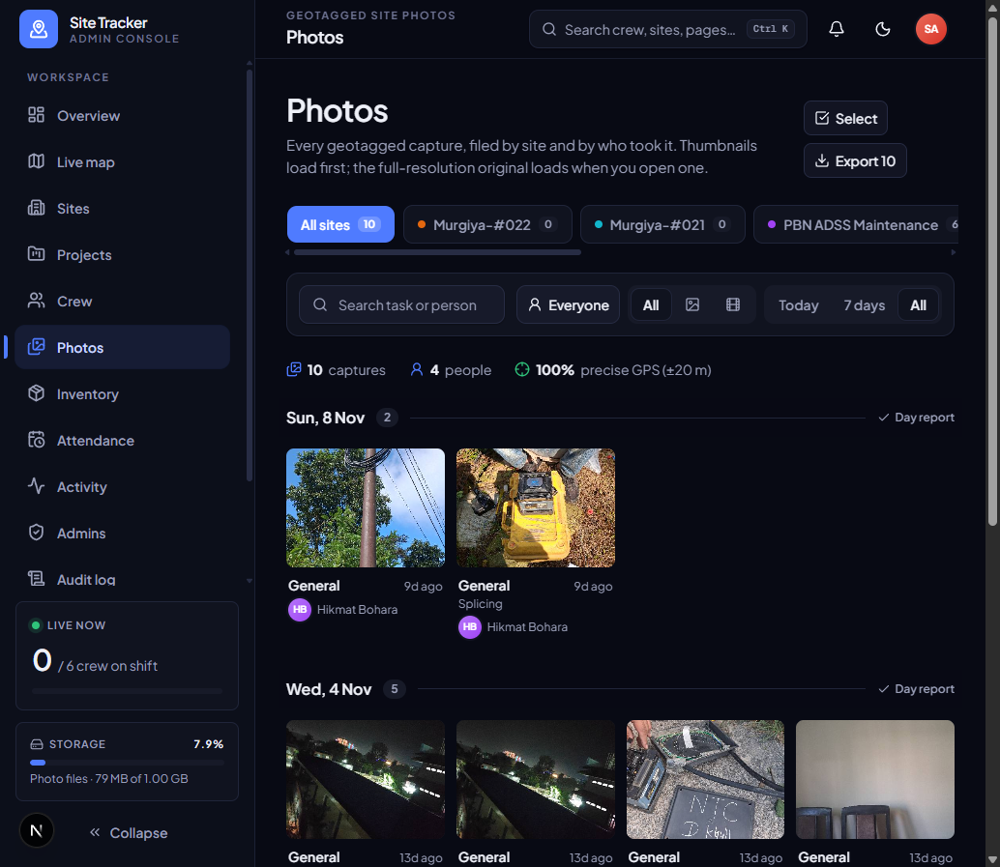
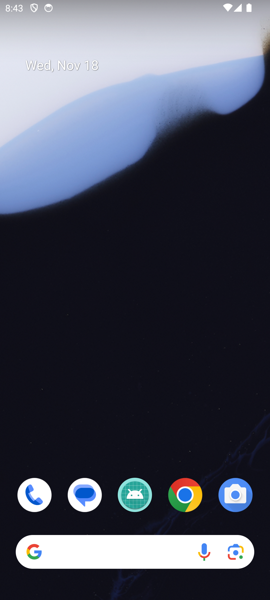

# New-photo stamp verification

Date: 18 November 2026. Android app: current `develop` working tree; no commits or pushes.

## Implemented behavior

- New photos receive a permanent black footer with white GPS coordinates, accuracy, capture date/time with UTC offset, and the final note.
- The footer is appended below the captured scene. Portrait/mirrored EXIF orientation is normalized; text wraps to fit the photo width.
- New captures opt in using a **local-only** `localStamp` field. Older uploaded photos and previously queued photos without that marker are not processed.
- Notes regenerate the stamped JPEG and its 400 px thumbnail from the retained original. The capture time does not change when editing or uploading.
- SQLite references are saved before old stamped derivatives are removed. Rendering failures retain the original and leave the photo queued for retry.
- Upload waits for a completed stamp, including manual sync while the note editor is open. Only the stamped image and thumbnail go to Supabase.
- Existing Firestore metadata remains available to maps, filters and sorting. No Firebase rules, shared schema or dashboard implementation changes.

## Automated verification

| Check | Result | Evidence |
| --- | --- | --- |
| React Native TypeScript | Pass | [typecheck.log](typecheck.log) |
| Android ARM64 native build | Pass | [build log](../../photo-stamp-android-build.log) |
| React Native Jest | **470 passed, 41 suites** | [jest-full.log](jest-full.log) |
| Changed TypeScript files lint | Pass, no errors or warnings | [lint-changed-final.log](lint-changed-final.log) |
| Repository-wide lint, initial run | No errors; 17,094 warnings (primarily line endings). Changed files subsequently cleaned. | [lint.log](lint.log) |
| Dashboard tests | **53 passed** | [web-tests.log](web-tests.log) |
| Dashboard TypeScript | Pass | [web-typecheck.log](web-typecheck.log) |
| Git whitespace check | Pass using repository Git settings | |

Tests include opting older photos out, signed coordinates, Nepal/negative timezone offsets, Unicode/multiline note formatting, note removal, regeneration from the original, serialized renders, storage/render failures and retry, current thumbnail generation, and manual-sync/edit exclusion.

## Emulator and browser verification

The user disconnected the physical phone and requested emulator verification. No claim of physical-phone feature verification is made.

Device: `Pixel_6_API_34`, Android 14, `sdk_gphone64_x86_64` image with ARM64 translation support.
Dashboard: http://127.0.0.1:3000/photos, signed in with the user's owner account.

**Not verified:** capture, edit, upload, stamped JPEG contents, final thumbnail, and unchanged older-file hash after upload. The first phone-targeted APK installed but failed emulator launch with a native-library loading error. A subsequent verification build completed, but a successful feature run was not recorded. The user then requested that development servers be closed; Expo/Metro and Next.js were stopped. Runtime tests remain incomplete and must not be treated as passing.

The screenshots below show the existing dashboard gallery and the emulator's captured state. They are **not evidence of a successful burned-in photo**.

The initial dashboard contained 10 older photos. One older original was fetched and SHA-256 hashed before device testing; see [baseline](old-photo-baseline.json).

## Scope and limits

- This is an Android native feature and requires a rebuilt app, not only a JavaScript update.
- Originals are retained in private app storage for recovery and note edits, so a new capture uses extra local storage. Only the stamped version is uploaded.
- No existing photo is retroactively stamped.
- No credentials are included in this report.
